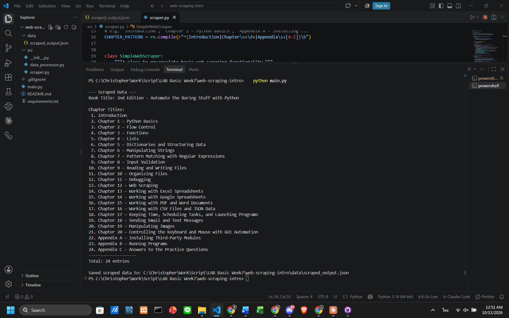

# Week 7: Introduction to Web Scraping

This project introduces the fundamentals of web scraping using Python's `requests` and
`BeautifulSoup4` libraries. It downloads the homepage of *Automate the Boring Stuff with Python*
(2nd Edition) and extracts the book title and the list of chapter titles.

## Important Note on Ethics and Legality
- Check the site's `robots.txt` (e.g. `https://automatetheboringstuff.com/robots.txt`) and Terms of Service before scraping.
- Respect rate limits: this scraper makes **one** request per run. If you extend it to many pages, add `time.sleep()` between requests.
- Prefer an official API when one exists.
- This project is for educational purposes only.

## Implemented Features
- **HTML Download** with `requests` (custom `User-Agent`, 10-second timeout).
- **HTML Parsing** with `BeautifulSoup4`.
- **Data Extraction**: book title + chapter titles and their absolute URLs.
- **Error Handling** for HTTP errors, connection errors and timeouts; every `find()` result is checked for `None`.
- **Save to JSON**: results are written to `data/scraped_output.json`.

## How to Run
```bash
python -m venv venv
venv\Scripts\activate            # Mac/Linux: source venv/bin/activate
pip install -r requirements.txt
python main.py
```

## Example Output
Result of running `python main.py`:



## Project Structure
```
web-scraping-intro/
├── src/
│   ├── __init__.py         # Makes 'src' a Python package
│   ├── scraper.py          # Download + parse + extract logic
│   └── data_processor.py   # Saves results to JSON
├── data/
│   └── scraped_output.json # Created when you run main.py
├── screenshots/
│   └── output.png          # Screenshot of the program output
├── main.py                 # Application entry point
├── requirements.txt
├── .gitignore
└── README.md
```

## How the Chapter Extraction Works
Rather than depending on CSS class names (which can change when a site is redesigned), the scraper
collects every `<a href>` tag and keeps those whose text matches `Introduction`, `Chapter N` or
`Appendix X`. Relative links are converted to absolute URLs with `urljoin`.

## Debugging Web Scraping
- **Inspect HTML:** open developer tools (F12) to see the real tags and classes.
- **Check `response.status_code`:** 200 means OK; 403/404/500 indicate a problem.
- **Print `response.text`:** confirm you actually received the HTML you expect.
- **Check for `None`:** `find()` returns `None` when nothing matches — check before calling methods on it.
- **User-Agent:** some sites block requests that lack one.

## Extension Ideas
- Scrape each chapter page (with `time.sleep()` between requests).
- Export to CSV as well as JSON.
- Accept the URL as a command-line argument.
- Use Selenium for JavaScript-heavy sites.

## License
MIT
