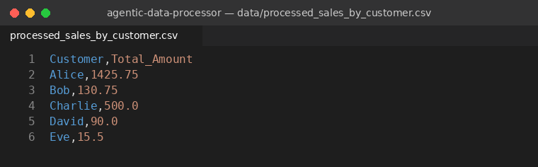
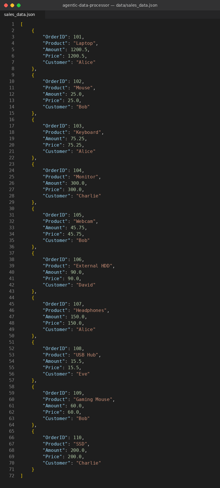
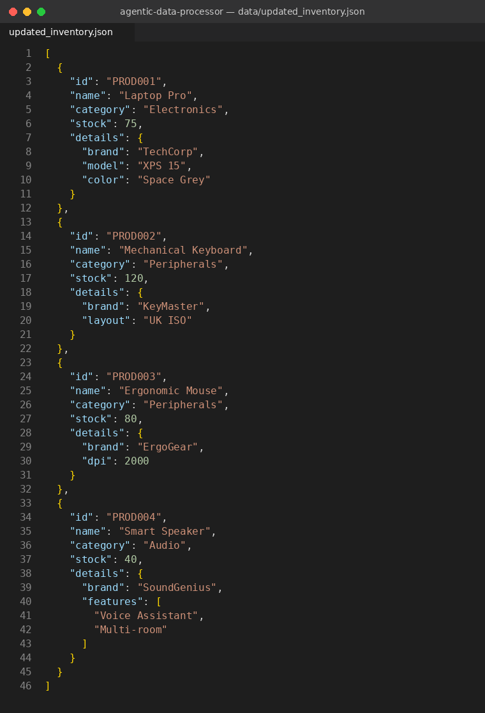

# LabX ADV: Agentic Data Processing (Advanced CSV & JSON Workflows)

An **Agentic Data Processor** that runs a multi-step data pipeline for CSV and JSON files, defined declaratively in `configs/data_pipeline_config.json`. The `DataAgent` reads the config, dispatches each task to its handler, passes intermediate results between tasks through an internal `data_store`, and writes a JSON audit report of every step.

## Pipeline (configs/data_pipeline_config.json)

| # | Task | Type | Input key → Output |
|---|------|------|--------------------|
| 1 | Load Sales Data CSV | `load_csv` | `data/input_sales.csv` → `raw_sales_data` |
| 2 | Aggregate Sales by Customer | `transform_csv_aggregate` | `raw_sales_data` → `customer_sales_summary` |
| 3 | Save Aggregated Sales CSV | `save_csv` | `customer_sales_summary` → `data/processed_sales_by_customer.csv` |
| 4 | Convert Raw Sales to JSON | `csv_to_json_conversion` | `raw_sales_data` → `raw_sales_json` |
| 5 | Save Raw Sales JSON | `save_json` | `raw_sales_json` → `data/sales_data.json` |
| 6 | Load Inventory Data JSON | `load_json` | `data/input_inventory.json` → `raw_inventory_data` |
| 7 | Update Inventory Stock & Add Product | `update_json_data` | `raw_inventory_data` → `updated_inventory_data` |
| 8 | Query Specific Product Detail | `query_json_data` | `updated_inventory_data` → `queried_product_brand` (= `TechCorp`) |
| 9 | Save Updated Inventory JSON | `save_json` | `updated_inventory_data` → `data/updated_inventory.json` |

An audit report `reports/audit_report_YYYYMMDD_HHMMSS.json` is generated at the end of every run.

## Output Screenshots

### 1. `data/processed_sales_by_customer.csv` — total sales per customer


### 2. `data/sales_data.json` — raw sales converted from CSV to typed JSON


### 3. `data/updated_inventory.json` — inventory after updates
Changes applied: PROD001 stock 50 → 75 and new `color`, PROD002 layout → `UK ISO`, PROD003 dpi → 2000, new product **PROD004 Smart Speaker** added.



## How to Run

```bash
git clone https://github.com/<YOUR_USERNAME>/agentic-data-processor.git
cd agentic-data-processor
python main.py
```

No external libraries are required (`csv`, `json`, `logging`, `os`, `datetime` are built-in). Tested with Python 3.13.

## Project Structure

```
agentic-data-processor/
├── src/
│   ├── __init__.py
│   ├── data_agent.py          # Orchestrator: task dispatcher + data_store + audit report
│   ├── csv_tasks.py           # load / save / aggregate / filter CSV
│   ├── json_tasks.py          # load / save / update / query JSON
│   ├── conversion_tasks.py    # CSV <-> JSON
│   ├── config_parser.py       # Loads and validates the pipeline config
│   └── utils.py               # Logging, directory helper, audit logging
├── configs/
│   └── data_pipeline_config.json
├── data/
│   ├── input_sales.csv
│   ├── input_inventory.json
│   ├── processed_sales_by_customer.csv   # output
│   ├── sales_data.json                   # output
│   └── updated_inventory.json            # output
├── reports/                   # audit_report_*.json
├── screenshots/               # screenshots of the 3 output files
├── main.py
├── AllCode.md
├── .gitignore
└── README.md
```

## Bug Fixes Applied to the Lab Source Code

The original lab code did not run as provided. These fixes were made:

1. **`main.py` – ImportError**: modules in `src/` use relative imports (`from .utils import ...`), so they must be imported as a package: `from src.data_agent import DataAgent`.
2. **`data_agent.py` – NameError `sys`**: `run()` used `sys.modules['__main__']` without importing `sys`. The base directory is now passed in from `main.py`.
3. **`csv_tasks.py` / `json_tasks.py` – NameError**: `ensure_directory_exists` was used but not imported.
4. **`config_parser.py` – ValueError**: every task was required to have `output_data_key`, but `save_csv`/`save_json` tasks don't have one. It is now required only for tasks that produce data.
5. **`json_tasks.py` – PROD004 never added**: an empty `path` (`""`) was skipped. It now means the root object, so `add_to_list` appends to the root list.
6. **`json_tasks.py` – `PROD001.details.color` was skipped**: path keys inside a list can now match an item by its `id`, as well as by index.
7. **`.gitignore`**: inline `# comments` broke patterns, and output files were ignored; outputs are now committed for submission.
8. The task dispatcher in `DataAgent` was refactored into a `handlers` dictionary (type → handler method).
