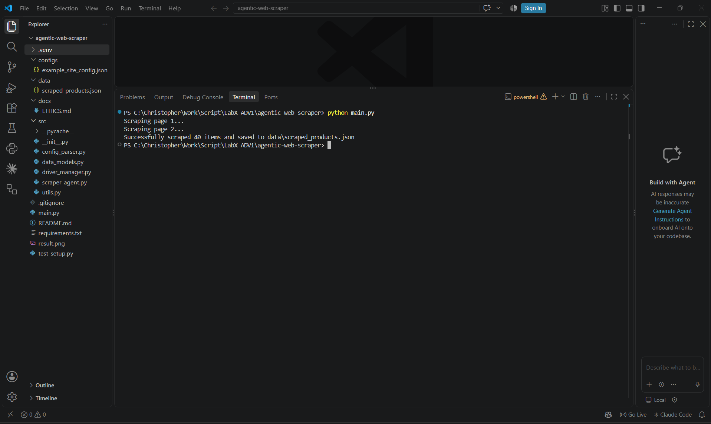

# LabX ADV: Advanced Web Scraping & Introduction to Automated Agents

"Agentic" web scraper ที่ใช้ **Selenium** ควบคุมเบราว์เซอร์จริง และทำงานตาม **ไฟล์ config (JSON)** — เปลี่ยนเว็บเป้าหมายได้โดยไม่ต้องแก้โค้ด

## ผลลัพธ์



```
Scraping page 1...
Scraping page 2...
Successfully scraped 40 items and saved to data\scraped_products.json
```

ไฟล์ผลลัพธ์: [`data/scraped_products.json`](data/scraped_products.json)

## แนวคิด Agent

| องค์ประกอบ Agent | ในโปรเจกต์นี้ |
|---|---|
| Goal (เป้าหมาย) | เก็บข้อมูลสินค้าให้ครบ `max_pages` หน้า |
| Plan (แผน) | `configs/example_site_config.json` |
| Perceive (รับรู้) | หา element ด้วย CSS selector / XPath |
| Act (ลงมือ) | ดึงข้อมูล → คลิกปุ่ม "next" |
| Adapt (ปรับตัว) | explicit wait, retry click, fallback CSS → XPath, หยุดเมื่อไม่มีหน้าถัดไป |

## โครงสร้างโปรเจกต์

```
agentic-web-scraper/
├── src/
│   ├── __init__.py          # Python package marker
│   ├── scraper_agent.py     # ตรรกะหลัก: อ่าน config, ดึงข้อมูล, เปลี่ยนหน้า
│   ├── config_parser.py     # โหลดและตรวจสอบ config
│   ├── data_models.py       # dataclass Product
│   ├── utils.py             # save JSON, explicit waits, robust click
│   └── driver_manager.py    # ตั้งค่า/ปิด Selenium WebDriver
├── configs/
│   └── example_site_config.json
├── data/
│   └── scraped_products.json
├── docs/
│   └── ETHICS.md
├── main.py
├── test_setup.py
├── requirements.txt
└── .gitignore
```

## คู่มือการ Setup โปรเจกต์ Agentic Web Scraper ใน VS Code

ต้องมี **Python 3.9+** และ **Google Chrome**

```bash
# 1) เข้าโฟลเดอร์โปรเจกต์
cd agentic-web-scraper

# 2) สร้างและเปิด virtual environment
python -m venv .venv
.venv\Scripts\activate          # Windows
# source .venv/bin/activate     # macOS / Linux

# 3) ติดตั้งแพ็กเกจ
pip install -r requirements.txt

# 4) (ไม่บังคับ) ตรวจว่าทุกอย่างพร้อม
python test_setup.py

# 5) รัน
python main.py
```

> ต้องรันจากในโฟลเดอร์ `agentic-web-scraper` — ถ้าเจอ `can't open file ... main.py` แปลว่ายังไม่ได้ `cd` เข้ามา

## Config

| Key | ความหมาย |
|---|---|
| `start_url` | หน้าแรกที่จะเริ่ม |
| `max_pages` | จำนวนหน้าสูงสุด |
| `delay_between_pages` | หน่วงเวลา (วินาที) ระหว่างหน้า เพื่อไม่ให้รบกวนเซิร์ฟเวอร์ |
| `item_container_selector` | selector ของสินค้า 1 ชิ้น |
| `pagination_selector` | selector ของปุ่ม/ลิงก์ "next" |
| `item_data_selectors` | selector ของแต่ละฟิลด์ (relative กับ container) — `null` = ไม่มีฟิลด์นี้ |

## บั๊กที่แก้จากโค้ดต้นฉบับ

1. `utils.py` — ขาด `import os`
2. `config_parser.py` — `"description": null` ทำให้ validation ไม่ผ่าน → อนุญาตค่า `null`
3. `scraper_agent.py` — ส่ง selector `None` เข้า `find_element` → ข้ามฟิลด์ที่เป็น `null`
4. `main.py` — import แบบ `from scraper_agent import ...` ชนกับ relative import → เปลี่ยนเป็น `from src.scraper_agent import ...`
5. `.gitignore` — เดิม ignore `data/` ทำให้ส่งไฟล์ผลลัพธ์ไม่ได้

## Ethics

ดู [docs/ETHICS.md](docs/ETHICS.md) — เว็บ `books.toscrape.com` สร้างขึ้นเพื่อฝึก scraping โดยเฉพาะ และโปรเจกต์นี้หน่วงเวลา 2 วินาทีระหว่างหน้า **ใช้เพื่อการศึกษาเท่านั้น**
