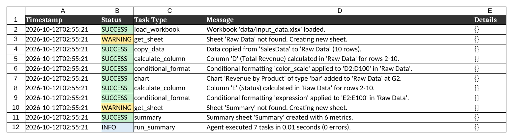
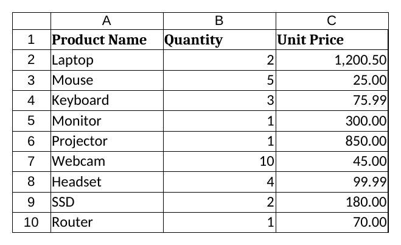
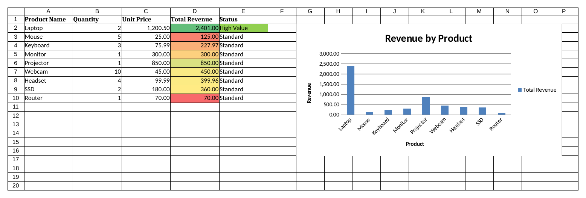
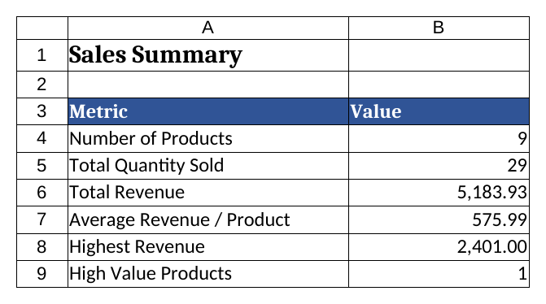

# Week 10: Advanced Spreadsheet Automation & Agentic Workflows

An **Agentic Spreadsheet Processor**: a Python agent that reads a JSON configuration (its "plan"),
then performs each task on an Excel workbook with `openpyxl` — copying data, inserting formulas,
applying conditional formatting, drawing a chart, building a summary sheet — and records every
step in an **Audit Log** sheet inside the output file.

## Screenshots (`data/output_report.xlsx`)

| Sheet | Screenshot |
|---|---|
| Audit Log |  |
| SalesData |  |
| Raw Data |  |
| Summary |  |

## Key Concepts Demonstrated

* **Advanced `openpyxl`**: bar/line/pie charts, conditional formatting (color scale, data bar,
  icon set, custom expression), Excel formulas written programmatically.
* **Config-driven "agent"**: `configs/example_spreadsheet_config.json` lists the tasks; the agent
  dispatches each task `type` to a handler method (`copy_data`, `calculate_column`,
  `conditional_format`, `chart`, `summary`).
* **Robustness**: every task runs inside its own `try/except`; a failing task is logged and the
  agent continues with the next one.
* **Logging & reporting**: console logging via Python `logging` (INFO / WARNING / ERROR / CRITICAL)
  plus an "Audit Log" sheet (status cells colour-coded) as the first sheet of the output workbook.

## Project Structure

```
week10/
├── src/
│   ├── __init__.py
│   ├── spreadsheet_agent.py     # Agent: task dispatching + Excel manipulation
│   ├── config_parser.py         # Loads and validates the JSON config
│   ├── utils.py                 # Logging and helper functions
│   └── google_sheets_utils.py   # Placeholder for future Google Sheets integration
├── configs/
│   └── example_spreadsheet_config.json
├── data/
│   ├── input_data.xlsx          # Sample input (sheet: SalesData)
│   └── output_report.xlsx       # Generated report
├── screenshots/                 # Screenshots of output_report.xlsx
├── create_input_data.py         # Creates data/input_data.xlsx
├── main.py                      # Entry point
├── .gitignore
└── README.md
```

## Setup & How to Run

```bash
python -m venv venv
source venv/bin/activate          # Windows: venv\Scripts\activate
pip install openpyxl

python create_input_data.py       # creates data/input_data.xlsx
python main.py                    # creates data/output_report.xlsx
# optional: python main.py path/to/another_config.json
```

Sample input (`data/input_data.xlsx`, sheet `SalesData`):

| Product Name | Quantity | Unit Price |
| :-- | --: | --: |
| Laptop | 2 | 1200.50 |
| Mouse | 5 | 25.00 |
| Keyboard | 3 | 75.99 |
| Monitor | 1 | 300.00 |
| Projector | 1 | 850.00 |
| Webcam | 10 | 45.00 |
| Headset | 4 | 99.99 |
| SSD | 2 | 180.00 |
| Router | 1 | 70.00 |

## Tasks in the Config

| # | type | What it does |
|---|---|---|
| 1 | `copy_data` | Copies `SalesData` → new sheet `Raw Data` |
| 2 | `calculate_column` | Column D `Total Revenue` = `=B{row}*C{row}` |
| 3 | `conditional_format` | 3-colour scale on `D2:D100` (red → yellow → green) |
| 4 | `chart` | Bar chart "Revenue by Product" from `D1:D10`, labels `A2:A10`, placed at `G2` |
| 5 | `calculate_column` | Column E `Status` = `=IF(D{row}>1000,"High Value","Standard")` |
| 6 | `conditional_format` | Green fill when `$E2="High Value"` |
| 7 | `summary` | `Summary` sheet with COUNTA / SUM / AVERAGE / MAX / COUNTIF formulas |

`{row}` in a formula is replaced with the current row number. Formulas are stored as formulas,
so Excel (or LibreOffice) calculates the values when the file is opened.

## Fixes Made to the Original Lab Code

| Problem in the handout | Fix |
|---|---|
| `main.py` used `from .src.utils import ...` (relative import in a script → `ImportError`) | Import as a package: `from src.config_parser import ConfigParser` |
| Config validator required `sheet` on every task, but `copy_data` has only `source_sheet`/`dest_sheet` → config always rejected | `copy_data` is validated on `source_sheet` + `dest_sheet` instead |
| `spreadsheet_agent.py` used `json.dumps` without `import json` → crash when writing the Audit Log | Added `import json` |
| `_get_sheet` silently created a missing **source** sheet | Source sheet lookup uses `create=False` and logs an ERROR |
| Chart categories `A1:A5` included the header, misaligning labels; axes hidden by default in openpyxl 3.1 | Categories start at row 2; axes enabled with `axis.delete = False` |
| `IconSetRule` arguments in the wrong order; expression rule used an invalid `add()` signature | Correct `IconSetRule(icon, type, values)` and `Rule(type="expression", ...)` |
| Formulas filled down to `sheet.max_row` (could hit empty rows) | Fill down to the last row that has data in column A |
| "Summary" sheet listed in the lab goals but not implemented | New `summary` task type |

## Debugging Tips

* **`KeyError: 'SheetName'`** – sheet names in the config must match the workbook exactly.
* **`#NAME?` / `#VALUE!` in Excel** – the formula string in the config is not valid Excel syntax.
* **Chart / formatting missing** – check `data_range`, `category_range` and `range` in the config.
* Check the console output and the **Audit Log** sheet to see which task failed and why.

## Extension Ideas

Google Sheets via `gspread` (`google_sheets_utils.py`), SQLite/CSV/Web-API ingestion tasks,
data-validation and sheet-protection tasks, task dependencies, and a GUI for building configs.
